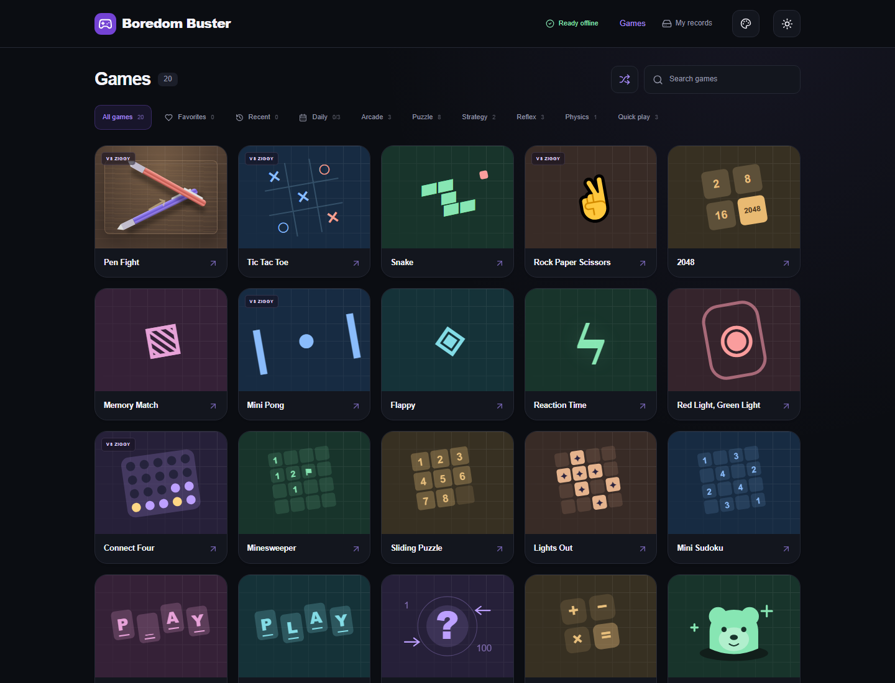
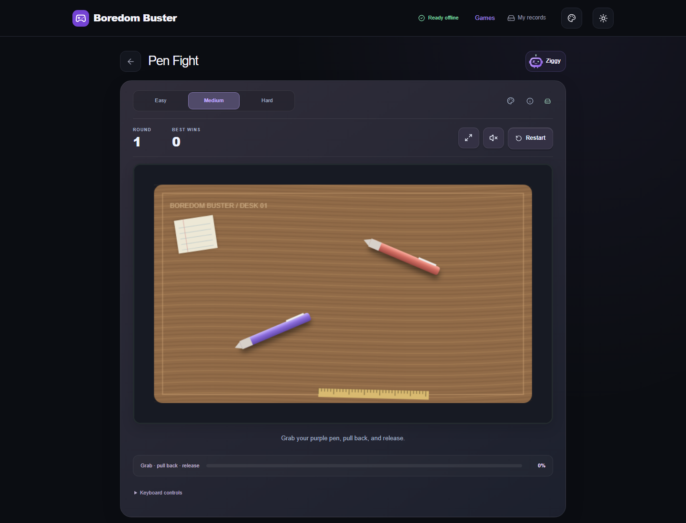
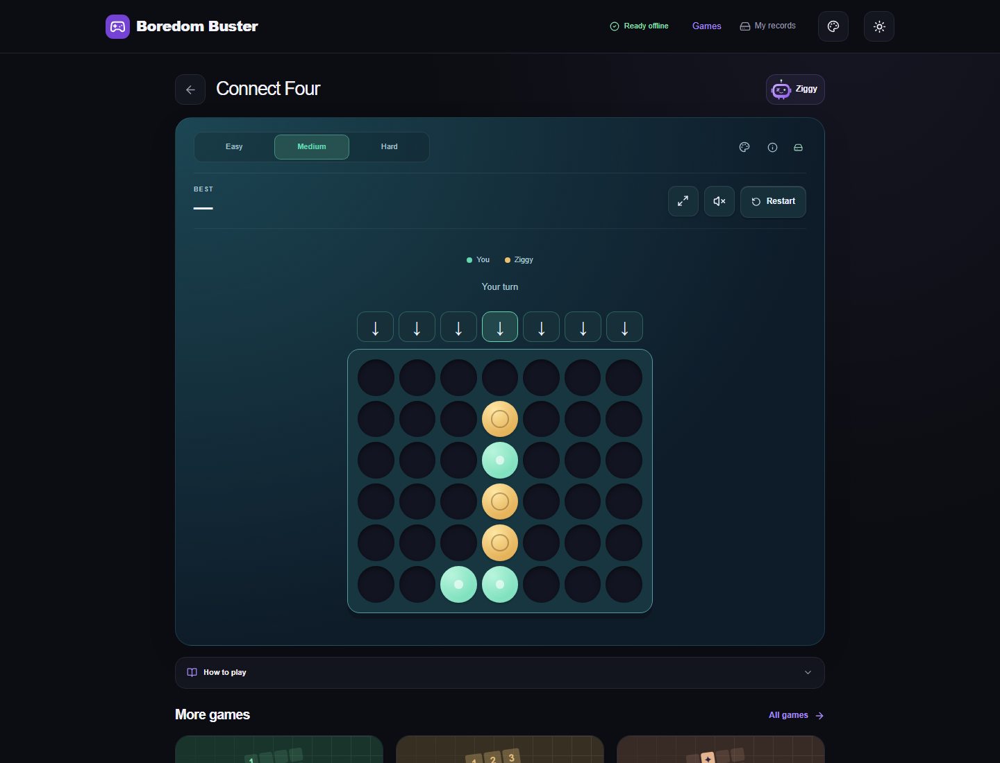
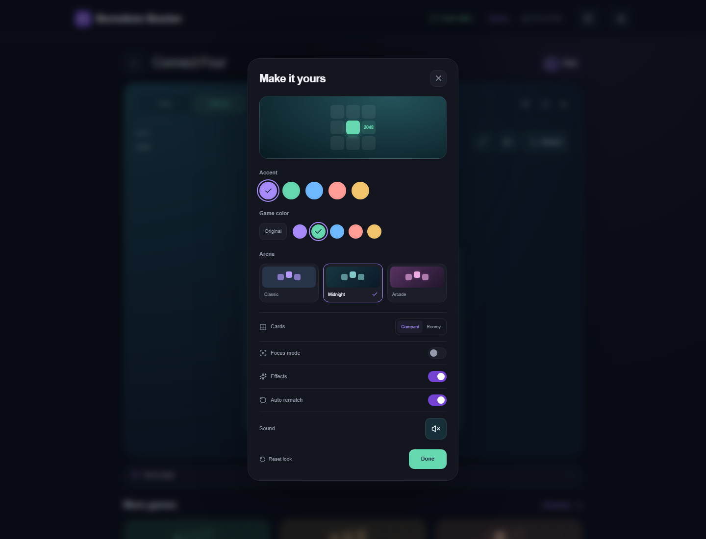
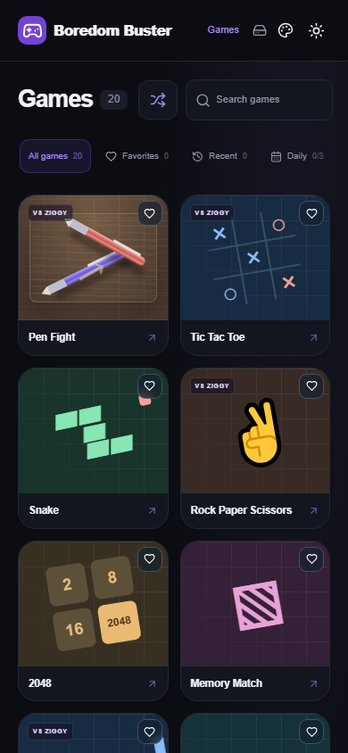

# Boredom Buster

Twenty free browser games with **Ziggy**, three difficulty modes, and offline play.

**[Play now](https://regal-valkyrie-a10d6b.netlify.app/)**

## Demo

Dark-mode previews. Click to view full size.

[](docs/screenshots/library-desktop.png)

| Pen Fight                                                                      | Connect Four                                                                            |
| ------------------------------------------------------------------------------ | --------------------------------------------------------------------------------------- |
| [](docs/screenshots/pen-fight.png) | [](docs/screenshots/connect-four.png) |

<details>
<summary>Customization and mobile previews</summary>

<p>
<a href="docs/screenshots/customization.png"></a>
<a href="docs/screenshots/library-mobile.png"></a>
</p>

</details>

## Features

- **20 games** with Easy, Medium, and Hard modes.
- **Offline play** after the first download finishes.
- **Local scores**, difficulty records, result sharing, and JSON backup downloads.
- **Favorites, recent games, and daily challenges.**
- **Custom looks:** five palettes, three arenas, per-game colors, light/dark themes, and focus mode.
- Keyboard, touch, sound controls, and automatic or manual rematches.

For offline use, open the site online and wait for **Ready offline**. Scores and settings belong to the same browser and website origin; clearing site data removes them. Backup import and cloud sync are not available.

## Run locally

Requires **Node.js 22+** and npm.

```sh
npm ci
npm run dev
```

Open [localhost:3000](http://localhost:3000). On Windows, use `npm.cmd` if PowerShell blocks npm scripts.

## Build and deploy

```sh
npm run build
npm run preview
```

Deploy **`out/`** to a static HTTPS host. Netlify settings are included. Set `NEXT_PUBLIC_SITE_URL` to your production URL before building. Offline support runs in production builds on HTTPS or localhost.

## Checks

```sh
npm run lint
npm run typecheck
npm test
```

For browser tests, install Chromium with `npx playwright install chromium`, keep the production preview running, then run `npm run test:browser`.

Built with **Next.js, React, TypeScript, and Matter.js**. See the [design research](docs/research/2026-10-24-casual-game-ux.md) for comparisons and future priorities.
